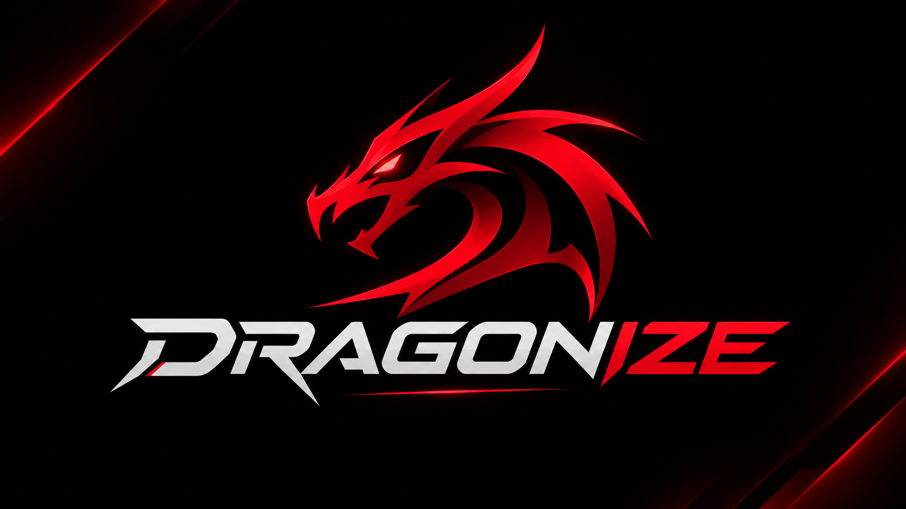
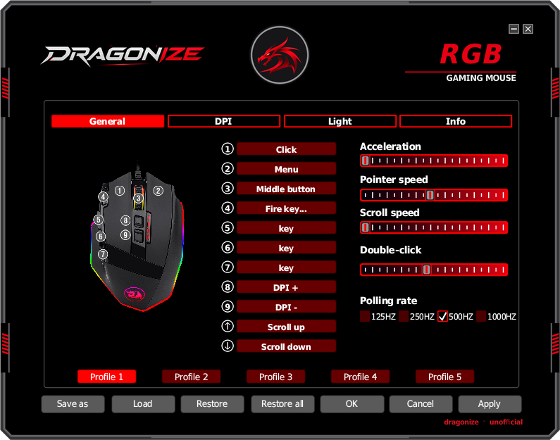
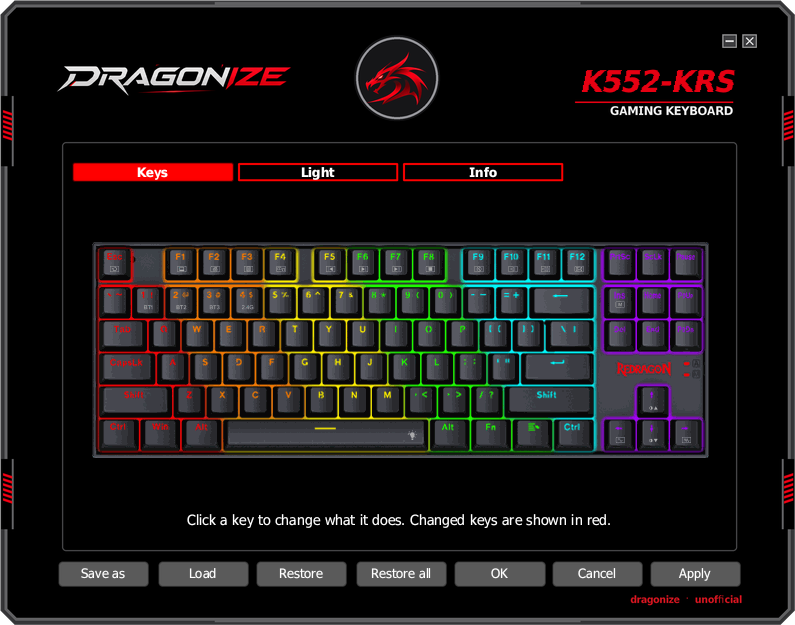
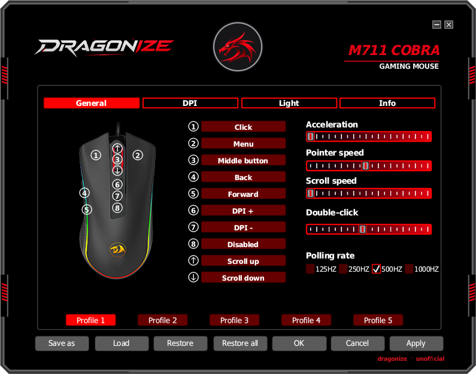
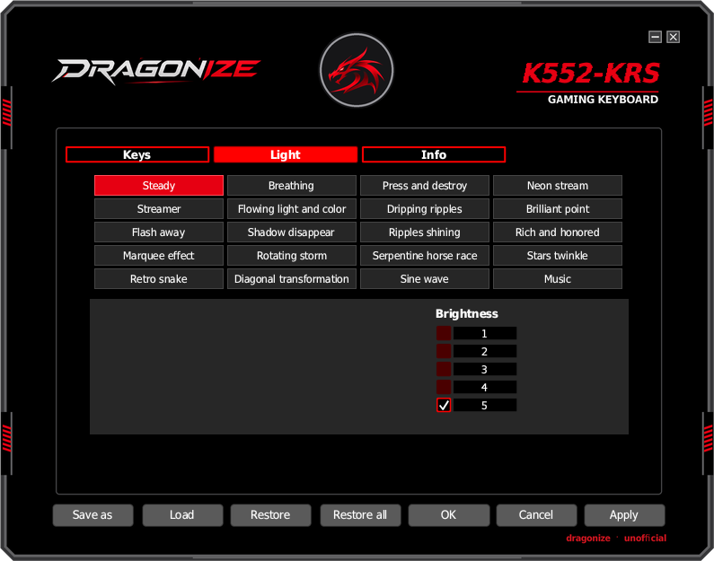

<p align="center">
  
</p>

<h1 align="center">Dragonize</h1>

<p align="center">
  Configure Redragon gaming mice and keyboards on Linux.<br>
  <b>Unofficial project. Not made, endorsed or supported by Redragon.</b>
</p>

<p align="center">
  <a href="README.md">English</a> ·
  <a href="README.pt-BR.md">Português (Brasil)</a>
</p>

> [!IMPORTANT]
> **Dragonize is in its testing phase.** It is being tested right now on the
> **Redragon M711 Cobra** and the **Redragon M801 Sniper**. Every other model was
> added by studying Redragon's own Windows software and has **not** been tried on
> real hardware yet. Your feedback is what makes each model work: please
> [open an issue](../../issues/new/choose) telling us what worked and what did
> not, and we will fix things case by case, right here in this project.

> [!WARNING]
> **Use at your own risk.** Dragonize writes settings to the memory of your
> device, the same way the official software does. Damage to the mouse or
> keyboard is very unlikely, but it is not impossible, and the authors cannot be
> held responsible for any problem, data loss or hardware failure. This software
> comes with no warranty of any kind.

## Screenshots

| Mice | Keyboards |
|---|---|
|  |  |
|  |  |

## What it does

Redragon only ships configuration software for Windows. Dragonize is a native
Linux application that talks to the device directly over USB (hidraw), with no
Wine.

**Mice**
* Button assignment: clicks, keys, key combos, media keys, office and browser
  shortcuts, DPI switching, fire key, macros
* Macro editor with recording of keys, modifiers (Ctrl, Shift, Alt, Super) and
  delays
* DPI levels and colors, polling rate, lighting effects
* Five on board profiles, saved and loaded from files
* The profile button under the mouse switches profiles like on Windows: a small
  background mode notices the press and applies that profile
* Pointer speed, acceleration and wheel speed per profile, applied to this mouse
  only (KDE Plasma and X11; double click speed is a desktop wide setting and is
  not changed)

**Keyboards**
* Key remapping (on models that support it)
* Lighting effects, colors, brightness and speed

**General**
* Interface in English, Português, Русский, 繁體中文 and 简体中文
* Detects the connected device and picks the right model automatically; when
  several models share the same USB id, it lets you choose
* Follows devices being plugged in and out while it is open, and shows a waiting
  screen when no supported device is connected

## Supported devices

The registry knows **374 models** (171 mice and 203 keyboards) from Redragon's
Windows downloads. Run `dragonize --list-models` to see all of them.

| Status | Devices |
|---|---|
| Tested on hardware | M801 Sniper (M801 RGB) |
| Being tested now | M711 Cobra |
| Implemented, waiting for testers | everything else in `--list-models` |

Some families are only partly supported (for example lighting only, or write
only, because the device cannot report its current settings). The app tells you
when that is the case. If your model is listed but misbehaves, or is not
listed at all, please open an issue.

## Install

1. Download `Dragonize-x86_64.AppImage` from the
   [latest release](../../releases/latest).
2. Make it executable and run it:
   ```sh
   chmod +x Dragonize-x86_64.AppImage
   ./Dragonize-x86_64.AppImage
   ```
3. The first time, Linux does not let normal users talk to USB devices
   directly. Dragonize offers to install a small udev rule that gives your user
   access to Redragon devices; your desktop asks for the administrator password
   once. You can also do it from a terminal:
   ```sh
   ./Dragonize-x86_64.AppImage --install-udev-rule
   ```

Opening Dragonize also starts its background mode and adds it to your login
programs (`~/.config/autostart/dragonize-daemon.desktop`). It only reads the
mouse until you press its profile button, and it uses only the profiles you saved
in Dragonize. To turn the start at login off: `./Dragonize-x86_64.AppImage --autostart off`.

Something not working? Run `./Dragonize-x86_64.AppImage --diagnose` and paste
the output into an issue.

## Reporting problems and feedback

This project grows with its users. When you open an issue, please include:

* the exact model name (printed on the box or under the device)
* your distribution and desktop (for example Fedora, KDE Plasma)
* the output of `dragonize --diagnose`
* what you did, what happened and what you expected

Reports that something **works** are just as useful: they let us mark a model
as tested.

## Build from source

Requires Rust 1.85 or newer.

```sh
cargo build --release
./target/release/dragonize
cargo test --release
```

Useful options (`dragonize --help` lists all of them):

| Option | What it does |
|---|---|
| `--diagnose` | Explains why the device can or cannot be used |
| `--daemon` | Runs the background mode (profile button, pointer settings) |
| `--autostart on\|off` | Starts the background mode at login, or stops doing so |
| `--list-models` | Lists the supported models |
| `--device-dump` | Prints the configuration stored on the connected mouse |
| `--no-device --model KEY` | Opens the editor for a model without a device |
| `--lang en\|pt\|ru\|tc\|sc` | Chooses the interface language |
| `--screenshot FILE --scene NAME` | Renders a screen to a PNG and exits |

To build the AppImage: `sh tools/build_appimage.sh /path/to/appimagetool`
(uses podman).

## Documentation

* [README.pt-BR.md](README.pt-BR.md): this page in Brazilian Portuguese
* [MECHANICS.md](MECHANICS.md): device protocol, memory map, rendering and
  branding/legal notes
* [tools/re/fleet/NOTES.md](tools/re/fleet/NOTES.md): notes on each device
  family and how support for it was derived
* [tools/re/rdcfg/README.md](tools/re/rdcfg/README.md): how the model data of
  Redragon's universal mouse driver was extracted
* [vendor/egui-winit/PATCHED.md](vendor/egui-winit/PATCHED.md): why a patched
  copy of egui-winit is bundled

## License

Dragonize is free software, licensed under the
[GNU Affero General Public License v3.0](LICENSE). The bundled copy of
egui-winit in `vendor/egui-winit/` keeps its original MIT or Apache 2.0
license, and the bundled fonts keep theirs (see below).

## Legal

Dragonize is an independent, unofficial project. It is not affiliated with,
endorsed by or supported by Redragon or its parent company. "Redragon" and the
product names are trademarks of their owners and appear here only to say which
devices are compatible. Product photos shown in the app belong to their owner.
Support was obtained through interoperability research on the official Windows
software; no vendor code is included. Bundled fonts: Wine Tahoma (LGPL) and Noto
Sans CJK TC subset (OFL), licenses in `assets/fonts/`.
