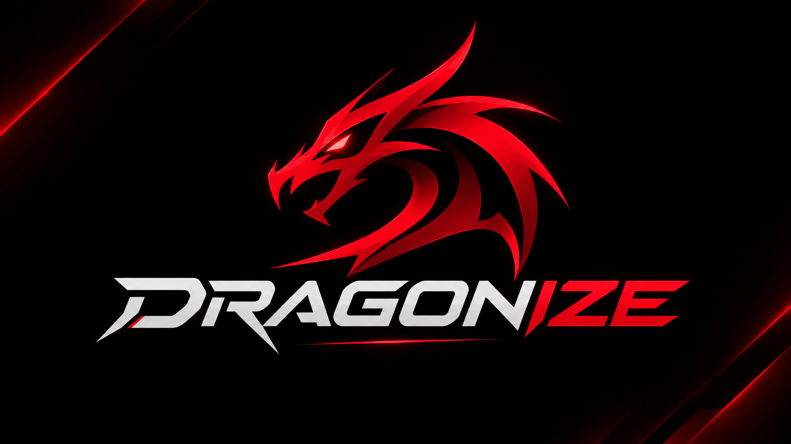
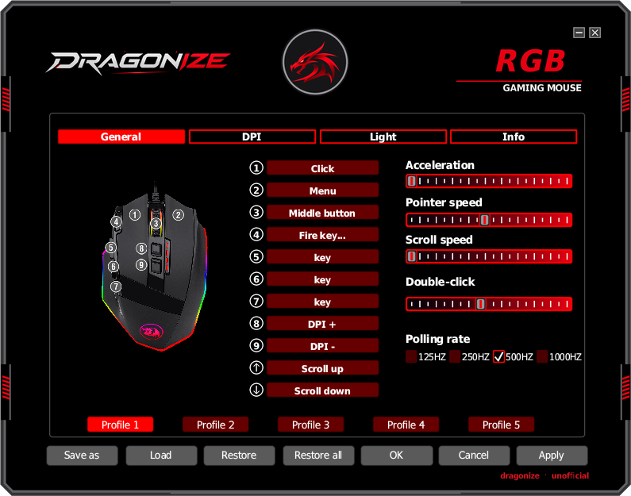
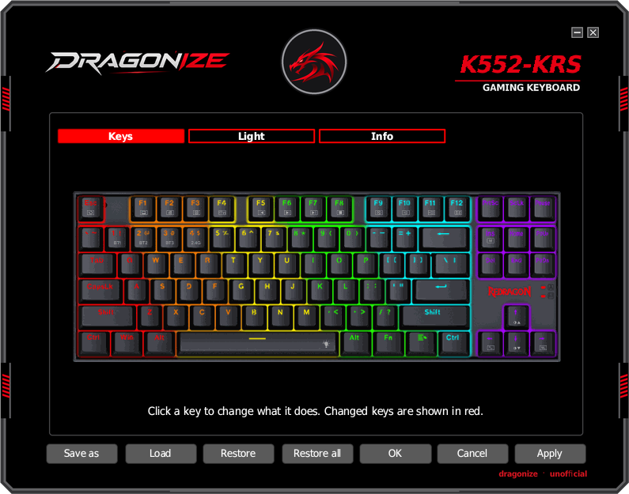
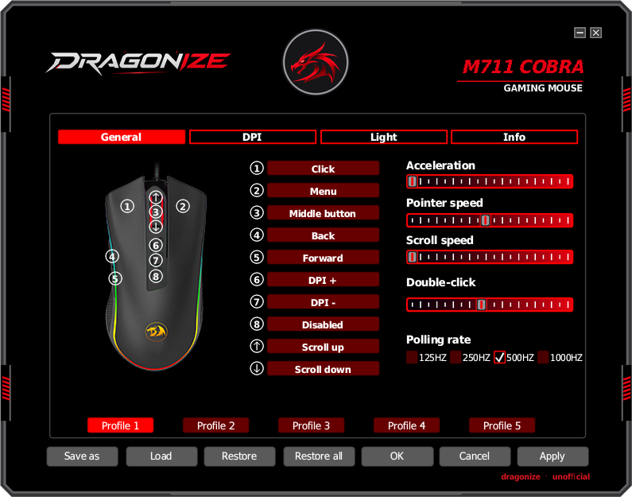
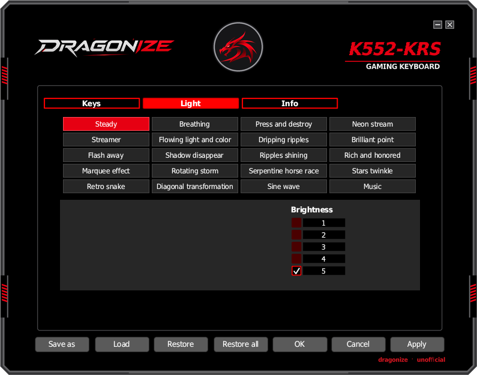

<p align="center">
  
</p>

<h1 align="center">Dragonize</h1>

<p align="center">
  Configure mouses e teclados gamer Redragon no Linux.<br>
  <b>Projeto não oficial. Não é feito, endossado nem suportado pela Redragon.</b>
</p>

<p align="center">
  <a href="README.md">English</a> ·
  <a href="README.pt-BR.md">Português (Brasil)</a>
</p>

> [!IMPORTANT]
> **O Dragonize está em fase de testes.** Neste momento ele está sendo testado no
> **Redragon M711 Cobra** e no **Redragon M801 Sniper**. Todos os outros modelos
> foram adicionados estudando o próprio software de Windows da Redragon e **ainda
> não** foram experimentados em hardware real. O seu feedback é o que faz cada
> modelo funcionar: por favor [abra uma issue](../../issues/new/choose) contando o
> que funcionou e o que não funcionou, e nós vamos resolver caso a caso, aqui
> mesmo no projeto.

> [!WARNING]
> **Use por sua conta e risco.** O Dragonize grava configurações na memória do
> dispositivo, do mesmo jeito que o software oficial. Danos ao mouse ou teclado
> (como queimar o aparelho) são muito improváveis, mas não impossíveis, e os
> autores não se responsabilizam por nenhum problema, perda de dados ou falha de
> hardware. Este software não tem nenhum tipo de garantia.

## Capturas de tela

| Mouses | Teclados |
|---|---|
|  |  |
|  |  |

## O que ele faz

A Redragon só disponibiliza software de configuração para Windows. O Dragonize é
um aplicativo nativo para Linux que conversa direto com o dispositivo via USB
(hidraw), sem Wine e sem serviço em segundo plano.

**Mouses**
* Função de cada botão: cliques, teclas, combinações, teclas de mídia, atalhos
  de escritório e de navegador, troca de DPI, tecla de disparo, macros
* Editor de macros com gravação de teclas, modificadores (Ctrl, Shift, Alt,
  Super) e atrasos
* Níveis e cores de DPI, taxa de polling, efeitos de iluminação
* Cinco perfis no próprio mouse, salvos e carregados de arquivos

**Teclados**
* Remapeamento de teclas (nos modelos que suportam)
* Efeitos de iluminação, cores, brilho e velocidade

**Geral**
* Interface em English, Português, Русский, 繁體中文 e 简体中文
* Detecta o dispositivo conectado e escolhe o modelo certo sozinho; quando
  vários modelos usam o mesmo id USB, ele deixa você escolher

## Dispositivos suportados

O registro conhece **374 modelos** (171 mouses e 203 teclados) dos downloads de
Windows da Redragon. Rode `dragonize --list-models` para ver todos.

| Situação | Dispositivos |
|---|---|
| Testado em hardware | M801 Sniper (M801 RGB) |
| Em teste agora | M711 Cobra |
| Implementado, aguardando testadores | todo o resto de `--list-models` |

Algumas famílias têm suporte parcial (por exemplo só iluminação, ou só escrita,
porque o aparelho não informa a configuração atual). O aplicativo avisa quando
for o caso. Se o seu modelo está na lista mas se comporta mal, ou não está na
lista, abra uma issue.

## Instalação

1. Baixe `Dragonize-x86_64.AppImage` da
   [última release](../../releases/latest).
2. Torne executável e rode:
   ```sh
   chmod +x Dragonize-x86_64.AppImage
   ./Dragonize-x86_64.AppImage
   ```
3. Na primeira vez, o Linux não deixa usuários comuns falarem direto com
   dispositivos USB. O Dragonize oferece instalar uma pequena regra udev que dá
   ao seu usuário acesso aos dispositivos Redragon; o desktop pede a senha de
   administrador uma vez. Também dá para fazer pelo terminal:
   ```sh
   ./Dragonize-x86_64.AppImage --install-udev-rule
   ```

Algo não funciona? Rode `./Dragonize-x86_64.AppImage --diagnose` e cole a saída
numa issue.

## Relatando problemas e feedback

Este projeto cresce com quem usa. Ao abrir uma issue, inclua:

* o nome exato do modelo (impresso na caixa ou embaixo do aparelho)
* sua distribuição e desktop (por exemplo Fedora, KDE Plasma)
* a saída de `dragonize --diagnose`
* o que você fez, o que aconteceu e o que esperava

Avisar que algo **funciona** é tão útil quanto: assim marcamos o modelo como
testado.

## Compilando do código fonte

Requer Rust 1.85 ou mais novo.

```sh
cargo build --release
./target/release/dragonize
cargo test --release
```

Opções úteis (`dragonize --help` mostra todas):

| Opção | O que faz |
|---|---|
| `--diagnose` | Explica por que o dispositivo pode ou não ser usado |
| `--list-models` | Lista os modelos suportados |
| `--device-dump` | Mostra a configuração gravada no mouse conectado |
| `--no-device --model CHAVE` | Abre o editor de um modelo sem o aparelho |
| `--lang en\|pt\|ru\|tc\|sc` | Escolhe o idioma da interface |
| `--screenshot ARQUIVO --scene NOME` | Renderiza uma tela em PNG e sai |

Para gerar o AppImage: `sh tools/build_appimage.sh /caminho/do/appimagetool`
(usa podman).

## Documentação (em inglês)

* [README.md](README.md): página principal, em inglês
* [MECHANICS.md](MECHANICS.md): protocolo, mapa de memória, renderização e
  notas de marca/legais
* [tools/re/fleet/NOTES.md](tools/re/fleet/NOTES.md): notas de cada família de
  dispositivos e de como o suporte foi obtido
* [tools/re/rdcfg/README.md](tools/re/rdcfg/README.md): como os dados de modelo
  do driver universal de mouses da Redragon foram extraídos
* [vendor/egui-winit/PATCHED.md](vendor/egui-winit/PATCHED.md): por que uma cópia
  modificada do egui-winit acompanha o projeto

## Aviso legal

O Dragonize é um projeto independente e não oficial. Não tem vínculo com a
Redragon nem com sua empresa controladora, nem é endossado ou suportado por elas.
"Redragon" e os nomes dos produtos são marcas de seus donos e aparecem aqui só
para indicar quais dispositivos são compatíveis. As fotos de produto exibidas no
app pertencem ao seu dono. O suporte foi obtido por pesquisa de
interoperabilidade no software oficial de Windows; nenhum código do fabricante
está incluído. Fontes incluídas: Wine Tahoma (LGPL) e subconjunto da Noto Sans
CJK TC (OFL), licenças em `assets/fonts/`.
